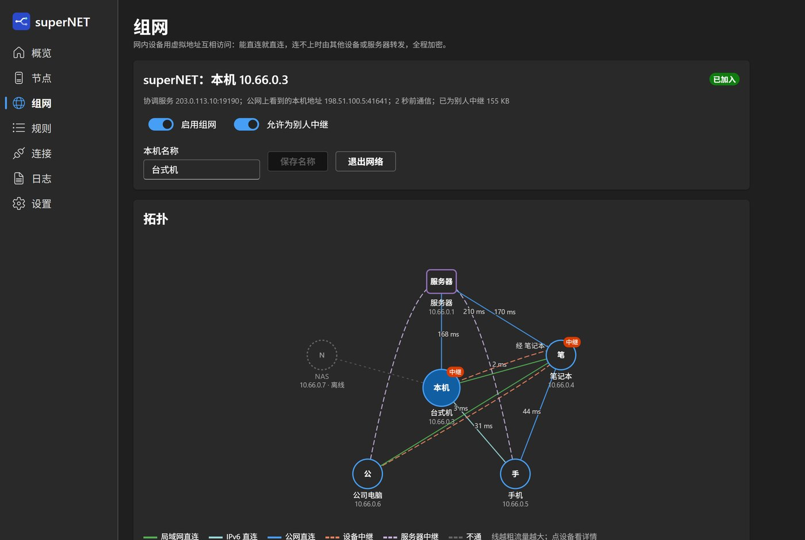
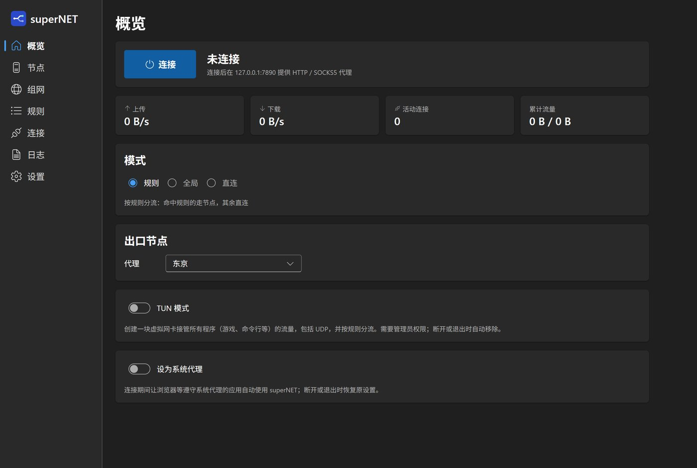
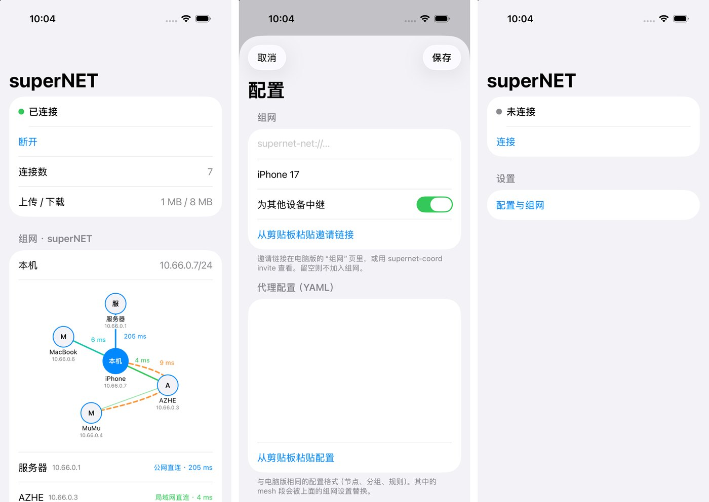
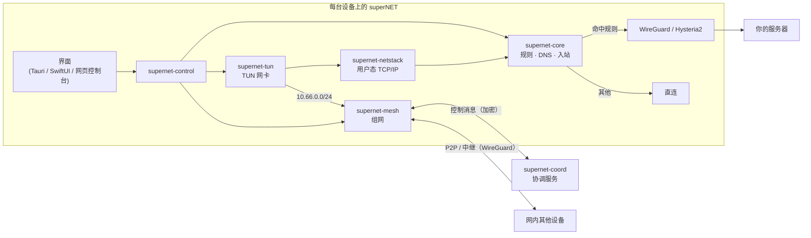

<div align="center">

# superNET

**按规则分流的代理 + P2P 优先的虚拟组网，一个应用搞定**

*Rule-based proxy and a peer-to-peer-first virtual LAN in one app — Windows, macOS, Linux, Android, iOS.*



</div>

superNET 只用**你自己的服务器**，把两件常用的事放进同一个应用：

- **分流代理**：命中规则的流量经你的服务器出去（WireGuard 或 Hysteria2），其余流量照常走本机网络。
- **虚拟组网**：你的每台设备都有一个固定的虚拟地址（`10.66.0.x`），不管在哪个网络里都能互相访问。能直连就点对点；连不上时由网内其他设备中继，最后才用服务器中继。全程端到端加密。

界面上有实时拓扑图，能看到每两台设备之间现在走的是哪条路、延迟多少、流量多大。

## 目录

- [功能](#功能)
- [平台](#平台)
- [工作原理](#工作原理)
- [快速开始](#快速开始)
- [配置](#配置)
- [从源码构建](#从源码构建)
- [项目结构](#项目结构)
- [安全](#安全)
- [现状与已知限制](#现状与已知限制)
- [许可证](#许可证)

## 功能

### 分流代理

- **节点**：
  - WireGuard（用户态，[boringtun](https://github.com/cloudflare/boringtun) + [smoltcp](https://github.com/smoltcp-rs/smoltcp)）；
  - 原生 Hysteria2（QUIC + TLS 1.3），适合丢包多的跨境线路，兼容 s-ui、sing-box 和官方服务端。
- **规则**：
  - `DOMAIN`、`DOMAIN-SUFFIX`、`DOMAIN-KEYWORD`、`IP-CIDR`、`IP-CIDR6`、`GEOIP`、`DST-PORT`、`RULE-SET`、`MATCH`；
  - 规则、全局、直连三种模式；
  - 节点分组手动选择。
- **两种接入方式**：
  - 本地 HTTP/SOCKS5 代理，可以自动设为系统代理，退出时恢复原设置；
  - **TUN 模式**：一块虚拟网卡接管所有程序的流量（包括 UDP 和游戏）。
- **DNS**：假 IP（`198.18.0.0/15`）让域名规则在 TUN 模式下照样生效。Windows 上还用 WFP 拦截其他网卡的 DNS 查询，防止泄漏。
- **只用加密传输**：出口只有 WireGuard 和 Hysteria2，不支持 SOCKS 这类明文上游。

### 虚拟组网

- **路径优先级**：局域网直连 → IPv6 直连 → 公网 IPv4 打洞 → 经网内设备中继 → 经服务器中继。每条路径持续探测，随时切到更好的那条。
- **打洞**：两边同时发包。对 Linux 那类 NAT，先发低 TTL 的“引子包”打开自己这侧的映射，避免对方的包先到、留下错误的连接记录。对称 NAT 打不通时自动改走中继。
- **端到端加密**：设备之间是 WireGuard 隧道；中继设备和服务器只转发密文，看不到内容。
- **服务器也是成员**：协调服务把服务器上内核 WireGuard 的 `wg0`（`10.66.0.1`）一并纳入组网，设备可以直接访问服务器。
- **实时拓扑图**：路径用颜色区分，中继路径画成经过中继设备的弧线，流量越大线越粗，并有流动动画。

### 多种界面，同一套功能

- 桌面和 Android 是 Tauri 应用，iOS 是原生 SwiftUI 应用。
- **没有屏幕的 Linux 服务器**：一条命令加入组网，用浏览器打开**网页控制台**管理。网页控制台和桌面版是同一套界面、同一套后端逻辑。

<table>
<tr>
<td width="50%"></td>
<td width="50%"></td>
</tr>
<tr>
<td align="center">桌面版（Windows / macOS / Linux 同一界面）</td>
<td align="center">iOS：连接状态与拓扑、设置、未连接状态</td>
</tr>
</table>

## 平台

| 平台 | 形式 | 代理 | TUN | 组网 | 实测情况 |
|---|---|:-:|:-:|:-:|---|
| **Windows** | 应用 + 命令行 | ✅ | ✅ wintun，WFP 防 DNS 泄漏 | ✅ | 实机 |
| **Android** | 应用（VpnService，前台服务） | ✅ | ✅ | ✅ | 模拟器，含局域网直连组网 |
| **macOS** | 应用 + 命令行 | ✅ 系统代理 | ✅ 需 root，经命令行版 | ✅ | M4 MacBook Air 实机 |
| **Linux 服务器** | 命令行 + 网页控制台 + systemd | ✅ | ✅ 全局或只组网 | ✅ | 服务器和 Ubuntu 虚拟机 |
| **Linux 桌面** | deb 包（应用 + 命令行） | ✅ | ✅ 需 root，经命令行版 | ✅ | Ubuntu 24.04 arm64 |
| **iOS** | SwiftUI 应用 + Packet Tunnel 扩展 | ✅ | ✅ | ✅ | 编译通过，模拟器跑过界面；装到真机需要付费开发者账号 |

## 工作原理



**协调服务**（`supernet-coord`）跑在你的服务器上，负责：
- 凭邀请链接登记设备，分配地址；
- 在设备之间交换候选地址（局域网、IPv6、公网）；
- 两边都打不通时转发密文。

它不保存任何流量内容。组网协议的设计见 [docs/DESIGN.md](docs/DESIGN.md)，各平台的详细用法见 [docs/GUIDE.md](docs/GUIDE.md)。

## 快速开始

### 1. 准备服务器

二选一，也可以两个都用：

**WireGuard 节点**（Debian / Ubuntu / CentOS / Rocky / Alma）：

```bash
sudo bash node/install.sh          # 内核 WireGuard + NAT，UDP 51820
sudo supernet-node peer add 电脑   # 输出配置、二维码和 supernet:// 链接
```

**Hysteria2 节点**：已有的 s-ui、sing-box 或官方服务端都能用。导入它的 `hysteria2://` 分享链接即可。

### 2. 部署协调服务（要用组网时）

```powershell
scripts/build-coord.ps1    # 交叉编译 Linux 静态程序
scripts/deploy-coord.ps1   # 装成 systemd 服务 supernet-coord，并打印邀请链接（supernet-net://…）
```

- 云服务商的安全组需要放行 **UDP 19190**（协调服务）和 **UDP 51820**（服务器的 wg0）。
- 邀请链接相当于网络密码，只发给自己的设备。

### 3. 客户端

| 平台 | 安装 | 使用 |
|---|---|---|
| Windows | 运行 `superNET.exe` | “节点”页粘贴链接 → 连接；要用组网，打开 TUN 模式，在“组网”页粘贴邀请链接 |
| Android | 安装 `superNET-arm64-release.apk` | 同上；第一次连接时允许 VPN |
| macOS | 解压 `superNET.app`，第一次右键选“打开” | 应用本身用系统代理；TUN 和组网按应用里提示的 `sudo …/supernet-cli … --tun` 运行 |
| Linux 桌面 | `sudo apt install ./superNET_*.deb` | 同 macOS |
| iOS | 见 [ios/README.md](ios/README.md) | — |

### 4. 没有屏幕的 Linux 服务器

```bash
sudo supernet join 'supernet-net://…' --name 我的服务器 --install-service
```

这条命令会：
- 生成设备密钥，写入 `/etc/supernet/profile.yaml`（权限 600）；
- 安装开机自启的 systemd 服务。

服务以 **只组网** 模式运行：只有 `10.66.0.0/24` 走虚拟网卡，服务器原有的路由和 DNS 都不动。

**网页控制台**默认只监听 `127.0.0.1:9090`，在自己电脑上通过 SSH 转发访问：

```bash
ssh -L 9090:127.0.0.1:9090 用户@服务器
# 再用浏览器打开 journalctl -u supernet 里打印的链接：http://127.0.0.1:9090/#token=…
```

## 配置

配置文件是 YAML，保存在应用的数据目录里（`profile.yaml`）。界面上的所有操作都会写回这个文件。手写的话大致是这样：

```yaml
mode: rule                    # rule | global | direct
listen: 127.0.0.1:7890        # 本地 HTTP / SOCKS5 代理
tun: false
system_proxy: false
dns:
  direct: [system, 223.5.5.5]

nodes:
  - name: 东京
    type: hysteria2
    server: hy2.example.com:443
    password: "…"
  - name: 家里
    type: wireguard
    endpoint: 203.0.113.10:51820
    private_key: "…"
    public_key: "…"
    address: [10.66.0.2/32]
    allowed_ips: [0.0.0.0/0]

groups:
  - name: 代理
    type: select
    nodes: [东京, 家里, DIRECT]

rules:
  - DOMAIN-SUFFIX,github.com,代理
  - IP-CIDR,10.66.0.0/24,代理,no-resolve
  - GEOIP,LAN,DIRECT
  - MATCH,DIRECT

mesh:                          # 用界面或 supernet join 加入组网时自动生成
  invite: "supernet-net://…"
  private_key: "…"
  name: 台式机
  relay: true
  enabled: true
```

Hysteria2 证书的处理方式：
- 正规证书（比如 Let's Encrypt）按正常方式校验；
- 自签证书用 `pin_sha256` 固定指纹，`supernet pin-cert host:port` 可以打印指纹；
- 带 `insecure=1` 的链接，导入时会读取当时的证书并自动改成固定指纹。

### 命令行

```text
supernet --profile profile.yaml [--tun | --mesh-only] [--web [IP:]端口] [--stats 10]
supernet join 邀请链接 [--name 设备名] [--profile 路径] [--install-service [--no-web]]
supernet mesh-probe --invite 邀请链接     # 不开 TUN，只看组网路径和候选地址
supernet tun-test --profile P            # 限时 TUN 自检：DNS、直连、节点、组网
supernet pin-cert host:port [sni]        # 打印 Hysteria2 服务器证书的 SHA-256
```

协调服务的管理命令：`supernet-coord invite | reset-invite | members | remove 10.66.0.x`。

## 从源码构建

Rust 用 stable。前端需要 Node.js 18 以上。

| 目标 | 在哪里构建 | 命令 |
|---|---|---|
| Windows 应用 | Windows | `scripts/build-app.ps1` |
| Android | Windows（SDK 37、NDK 27、JDK 17） | `scripts/build-android.ps1 -Release -Targets x86_64,aarch64` |
| Linux 命令行（x86_64 静态） | Windows（Zig 交叉编译） | `scripts/build-linux.ps1` |
| Linux 应用（deb） | Debian / Ubuntu | `./scripts/build-linux-app.sh --deps` |
| macOS 应用 | Mac | `./scripts/build-macos.sh` |
| macOS 应用 | Windows（需要从 Mac 拷来 SDK 存根） | `scripts/build-macos-app.ps1` |
| iOS | Mac（Xcode） | `ios/build.sh device`，Rust 核心可以在 Windows 上用 `scripts/build-ios-lib.ps1` 交叉编译 |
| 协调服务 | Windows | `scripts/build-coord.ps1` |

Windows 上用的是 `windows-gnu` 工具链加 [llvm-mingw](https://github.com/mstorsjo/llvm-mingw)，不需要 Visual Studio。用环境变量 `SUPERNET_MINGW` 指向 llvm-mingw 的 `bin` 目录，然后：

```powershell
scripts/cargo.ps1 test --workspace
```

交叉编译用 [Zig](https://ziglang.org/) 当 C 编译器和链接器，`tools/zigcc` 是它的包装程序。

## 项目结构

| 路径 | 内容 |
|---|---|
| `crates/supernet-core` | 配置、规则引擎、DNS（含假 IP）、HTTP/SOCKS5 入站、出站、连接统计 |
| `crates/supernet-wg` | 用户态 WireGuard 出站（boringtun + smoltcp） |
| `crates/supernet-hy2` | 原生 Hysteria2 客户端 |
| `crates/supernet-netstack` | TUN 模式的用户态 TCP/IP 协议栈；把自己的连接固定到物理网卡，避免绕回 TUN |
| `crates/supernet-tun` | TUN 网卡、路由和 DNS 接管（Windows / Linux / macOS / Android / iOS） |
| `crates/supernet-mesh` | 组网：协调协议、选路、打洞、中继 |
| `crates/supernet-coord` | 协调服务 |
| `crates/supernet-control` | 界面背后的全部操作，桌面应用和网页控制台共用 |
| `crates/supernet-cli` | 命令行 `supernet`：无界面运行、加入组网、网页控制台、诊断工具 |
| `crates/supernet-sysproxy` | 系统代理：Windows、macOS、GNOME |
| `crates/supernet-ffi` | 给 iOS 用的 C 接口 |
| `crates/supernet-testnode` | 本地测试节点和端到端测试 |
| `app/` | Tauri 2 + React + Fluent UI 界面；`app/src-tauri/gen/android` 是 Android 工程 |
| `ios/` | iOS 应用和 Packet Tunnel 扩展 |
| `node/` | WireGuard 节点安装脚本 |
| `vendor/smoltcp` | 打过补丁的 smoltcp（修复隧道内 TCP 卡顿，见 `SUPERNET-PATCH.md`） |
| `docs/` | 设计文档 |

## 安全

- **密钥只在本机**：设备私钥和节点密码只存在本机的配置文件里（类 Unix 系统上权限是 600），不会发给协调服务。
- **邀请链接**是加入网络的唯一凭证，泄露后用 `supernet-coord reset-invite` 换掉。
- **移除设备**：`supernet-coord remove` 之后重启协调服务，它会同时从服务器的 `wg0` 上删掉这台设备。
- **中继看不到内容**：协调服务和中继设备只转发 WireGuard 密文。
- **网页控制台**：
  - 默认只监听本机，每个请求都要带令牌；
  - 令牌通过链接的 `#token=` 交给页面（不会发到服务器的访问日志里），页面拿到后马上从地址栏清掉；
  - 它是明文 HTTP，请用 `ssh -L` 访问，不要直接监听公网。
- **防止流量绕回**：TUN 模式下，superNET 自己的连接被固定在物理网卡上。如果检测到别的 VPN 或 TUN（Clash、Shadowrocket 等）占着默认路由，会拒绝启动，而不是叠在上面造成循环。

发现安全问题请开 issue 说明（不要在 issue 里贴邀请链接、密钥或服务器地址）。

## 现状与已知限制

这是一个个人项目，版本 0.1。每项功能实际在哪些环境验证过，都记在 [PROGRESS.md](PROGRESS.md) 里。

- **iOS**：还没在真机上跑过隧道，因为 Network Extension 需要付费开发者账号。
- **跨网络打洞**：
  - 在 NAT 实验环境（网络命名空间）里验证过：两个锥形 NAT 能打通，对称 NAT 会回退到中继；
  - 公网上验证过 IPv6 直连；
  - 中国移动 4G 下的真机打洞还没测。
- **Linux 图形包**：目前只构建过 arm64 的 deb。x86_64 版要在 x86_64 机器上运行 `build-linux-app.sh`。
- **Hysteria2**：暂不支持 obfs 混淆。
- **macOS 和 Linux 桌面的 TUN 模式**：需要用 sudo 运行命令行版，应用本身没有提权助手。

## 许可证

MIT 或 Apache-2.0，任选其一（[LICENSE-MIT](LICENSE-MIT)、[LICENSE-APACHE](LICENSE-APACHE)）。`vendor/smoltcp` 沿用其原有的 0BSD 许可证。
